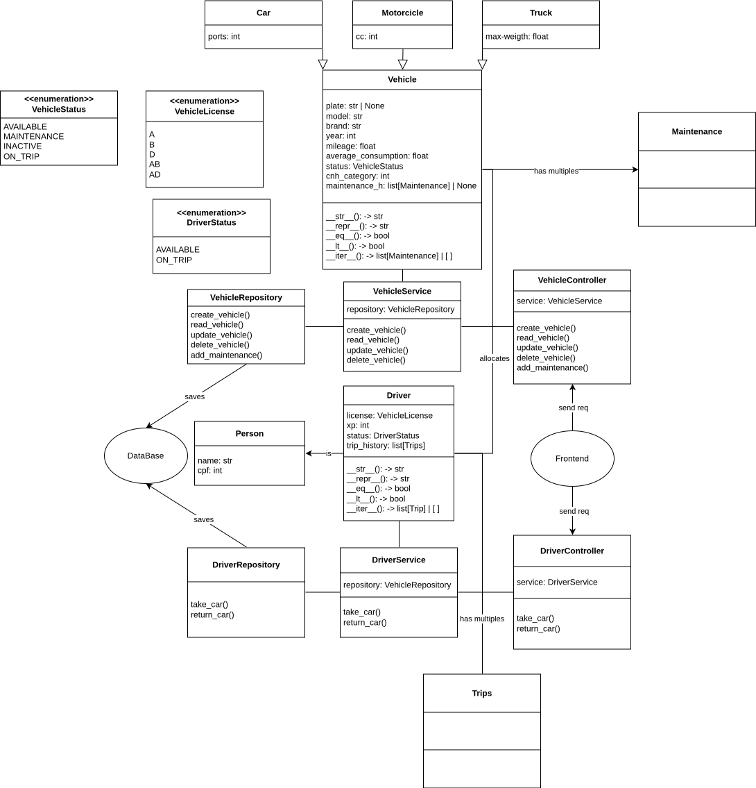

# Vehicle Fleet Management System (vfms)
The vfms project is a cli program writted in python - using the oriented object programming paradigm - that allows organizations to manage they vehicle fleet.

## Summary
- [Description](#description)

- [Objective](#objective)

- [UML](#uml)

- [File Structure](#file-structure)

- [Running](#running)

## Description
The vfms project is a cli program writted in python - using the oriented object programming paradigm - that allows organizations to manage they vehicle fleet.

## Objective
Learn how to use OOP and create a functional program.

## UML 



## File Structure

```text


```

## Running
You can use the following commands to run the program:

#### Linux and MacOs

```bash
curl -LsSf https://astral.sh/uv/install.sh | sh
git clone https://github.com/TocaiaLd/vfms.git
cd vfms
uv run vfms
```
#### Windows

```bash
powershell -ExecutionPolicy ByPass -c "irm https://astral.sh/uv/install.ps1 | iex"
git clone https://github.com/TocaiaLd/vfms.git
cd vfms
uv run vfms
```


