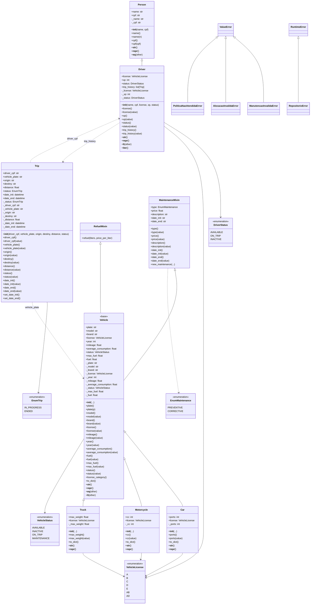
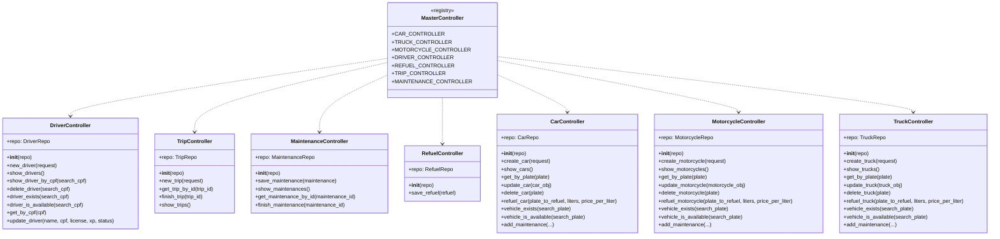
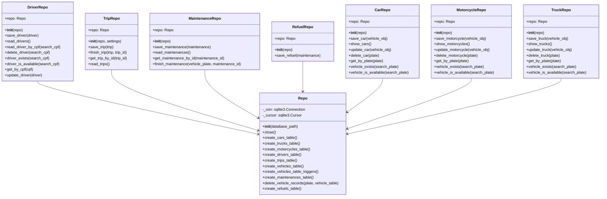
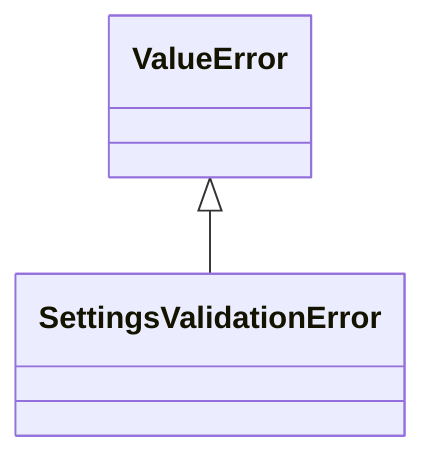

# Vehicle Fleet Management System (vfms)

The vfms project is a command-line application written in Python using object-oriented programming. It helps organizations manage their vehicle fleets.

## Summary

- [Description](#description)
- [Objective](#objective)
- [UML](#uml)
- [File Structure](#file-structure)
- [Requirements](#requirements)
- [Installation](#installation)
- [Running](#running)
- [Data and Configuration](#data-and-configuration)
- [Reports](#reports)
- [Tests](#tests)
- [Classes and Architecture](#classes-and-architecture)
- [Design Decisions](#design-decisions)

## Description

The vfms project is a command-line application written in Python using object-oriented programming. It helps organizations manage vehicles, drivers, trips, refueling, and maintenance.

## Objective

Learn how to use OOP and create a functional program.

## UML

### Domain Models and Enums

The diagrams flow from top to bottom. Long method signatures are abbreviated with `...` to keep class boxes narrow.



### Controllers



### Repositories



### Configuration



## File Structure

```text
src/vfms/controllers/  Coordinate application operations
src/vfms/models/       Domain objects and shared behaviors
src/vfms/repos/        SQLite persistence
src/vfms/view/         Interactive terminal menus
src/vfms/enums/        Status, maintenance, trip, and license values
src/vfms/config/       Application settings and validation
src/vfms/exceptions.py Business and persistence exceptions
db/                    Local SQLite database
tests/                 Model, repository, report, and interface tests
```

## Requirements

- Python 3.14 or later
- [uv](https://docs.astral.sh/uv/getting-started/installation/)
- Runtime libraries: `questionary`, `prompt-toolkit`, and `tabulate` (installed by `uv sync`).
- Test runner: `pytest` (included in the project's development dependency group).

## Installation

Install `uv` if needed:

```bash
# Linux and macOS
curl -LsSf https://astral.sh/uv/install.sh | sh
```

```powershell
# Windows
powershell -ExecutionPolicy ByPass -c "irm https://astral.sh/uv/install.ps1 | iex"
```

Clone the repository and install the project dependencies:

```bash
git clone https://github.com/TocaiaLd/vfms.git
cd vfms
uv sync
```

## Running

```bash
uv run vfms
```

Use the arrow keys to navigate menus and press Enter to select an option. Follow the prompts to add or update records. Use the back option in a menu to return to the previous screen.

### Main Menu

- **Vehicles:** create, list, update, delete, or refuel cars, motorcycles, and trucks.
- **Drivers:** register, list, search by CPF, update, or delete drivers.
- **Trips:** create, list, or finish trips. Select an available driver and vehicle, then enter the trip details. A compatible driver's license is required.
- **Maintenances:** list, add, or finish vehicle maintenance records.
- **Reports:** view maintenance costs, fuel efficiency, trips per driver, average mileage by vehicle type, and vehicle inventory.

## Data and Configuration

The application creates and uses `db/sqlite3.db` for local data. The database schema is initialized when the application starts. Set `VFMS_DATABASE_PATH` to select another SQLite file; tests use `:memory:` or temporary databases and do not modify the checked-in database. Vehicle-specific tables synchronize with the shared `vehicles` table through SQLite triggers. Vehicle deletion removes associated trips, maintenance records, and refuels in one transaction. A driver with trip history cannot be deleted so historical trips retain a valid driver reference.

Settings in `src/vfms/config/settings.json` define preventive maintenance intervals and reference costs, acceptable fuel-consumption ranges, and minimum license categories. Trucks require category C or higher; categories D and E satisfy that threshold.

## Reports

The reports menu reads persisted rows through the existing repositories. It includes total and average maintenance costs by vehicle type, average fuel consumption with efficiency ranking and configured-range checks, trips per driver, average odometer readings by vehicle type, and a vehicle inventory report. Empty tables produce empty reports without placeholder records.

## Tests

Run the suite with:

```bash
uv run pytest
```

Repository and report tests use isolated SQLite databases. The suite covers driver availability and history, vehicle CRUD and related-record deletion, trip allocation and preventive maintenance, maintenance/refuel persistence, settings-based policies, report calculations, serialization, and menu navigation.

## Classes and Architecture

| Area | Classes | Responsibility |
| --- | --- | --- |
| People | `Person`, `Driver` | `Person` provides shared identity data; `Driver` adds license, experience, status, and trip history. |
| Vehicles | `Vehicle`, `Car`, `Motorcycle`, `Truck` | `Vehicle` contains shared vehicle attributes and validation; each subclass adds its type-specific data. `Vehicle` also uses `RefuelMixin` and `MaintenanceMixin`. |
| Operations | `Trip` | Stores trip details, status, and start/end dates. |
| Shared behavior | `RefuelMixin`, `MaintenanceMixin` | Provide refueling and maintenance-record operations to vehicle models. |
| Controllers | `DriverController`, `TripController`, `MaintenanceController`, `RefuelController`, `CarController`, `MotorcycleController`, `TruckController` | Coordinate user-facing operations between models and repositories. |
| Repositories | `Repo`, `DriverRepo`, `TripRepo`, `MaintenanceRepo`, `RefuelRepo`, `CarRepo`, `MotorcycleRepo`, `TruckRepo` | `Repo` owns the SQLite connection and schema; specialized repositories persist each domain area. |
| Shared values | `VehicleStatus`, `DriverStatus`, `EnumTrip`, `EnumMaintenance`, `VehicleLicense` | Enumerate supported states, maintenance types, trip states, and license categories. |
| Application wiring | `MasterController` | Provides the shared controller instances used by the terminal views. |
| Configuration | `SettingsValidationError` | Reports invalid application settings loaded from JSON. |
| Errors | `ManutencaoInvalidaError`, `AlocacaoInvalidaError`, `PoliticaNaoAtendidaError`, `RepositorioError` | Distinguish maintenance, allocation, policy, and persistence failures. |

## Design Decisions

- Inheritance keeps shared person and vehicle attributes in base classes, while vehicle subclasses contain only type-specific fields.
- Mixins provide refueling and maintenance behavior that is shared across vehicle types.
- Views, controllers, models, and repositories have separate responsibilities, keeping terminal interaction apart from persistence and domain behavior.
- Enums represent finite states and categories instead of relying on arbitrary strings throughout the application.
- SQLite keeps data local without requiring a separate database server. Vehicle-specific tables are synchronized with the shared `vehicles` table using SQLite triggers.
- JSON settings make maintenance intervals, reference costs, fuel ranges, and license requirements configurable; the settings module validates them at startup.


